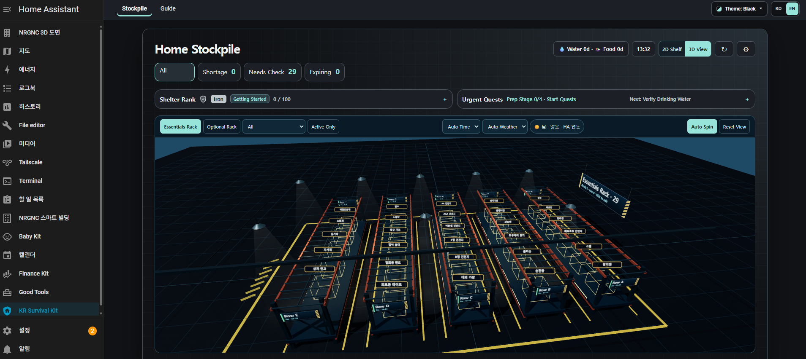
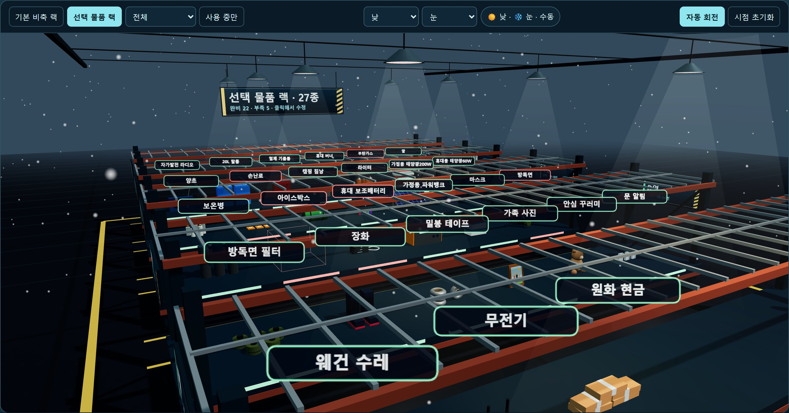
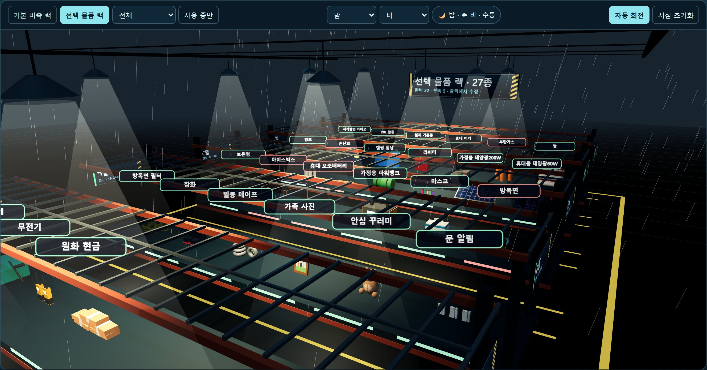
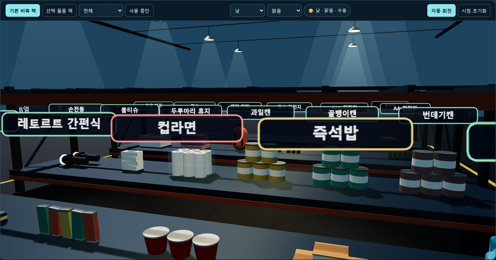
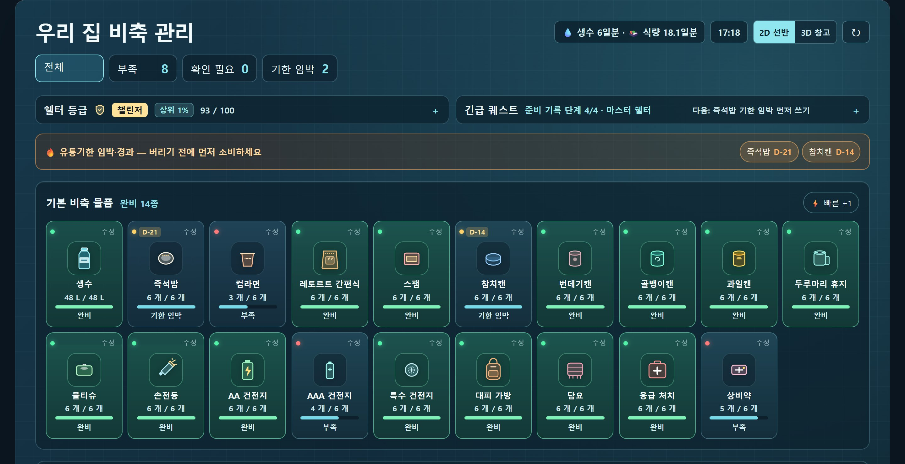

# KR Survival Kit

[한국어](README.md) | [English](README.en.md)

**A Home Assistant integration for managing household emergency supplies with FIFO rotation, shelter readiness tracking, 2D/3D warehouse views, and offline action guides.**

  
   3D Warehouse View (Night Mode)

During power outages, water shutoffs, or civil defense emergencies, you should know at a glance how many days of water and food your household actually has left.

KR Survival Kit helps you track everyday consumables (bottled water, canned goods, instant meals, medicine, batteries) so you rotate and consume them before expiration rather than letting supplies go to waste. It includes a 2D shelf view, a Three.js WebGL 3D warehouse, shelter rank progression, urgent restocking quests, and offline printable guides.

[Features](#features) · [Screenshots](#screenshots) · [Installation](#installation) · [Usage](#usage) · [FAQ](#faq) · [Support](#support)

---

## Features

| Feature | Description |
|---|---|
| **Survival Days Estimate** | Calculates expected days of drinking water and food remaining based on your household size. |
| **Expiration Alerts** | Highlights expiring or expired items at the top of the dashboard to encourage timely rotation. |
| **Medicine, Battery & Filter Dates** | Tracks use-by and inspection dates for over-the-counter medicine, batteries, butane canisters, and gas mask filters. |
| **111 Granular Items** | Separates supplies individually (water, instant rice, spam, tuna, bandages, headlamps, power banks, etc.). |
| **Custom Items** | Add your own household items (such as pet food or specialized gear) with custom units and date rules. |
| **Storage Location Notes** | Record where each item is stored (e.g. pantry shelf, hallway closet) for quick retrieval. |
| **Themes & Language Switch** | Includes 11 themes (Black, White, Blue, Ivory, Cute, Future, Cyber, Mecha, Pastel, Obsidian, Horror) and instant `KO / EN` UI switching. |
| **Shelter Rank & Urgent Quests** | Ranks readiness from Iron to Challenger with estimated percentile tiers and surfaces priority restock quests. |
| **Interactive 3D Warehouse** | Inspect shelves in WebGL 3D with drag rotation, zoom, raycast click-to-edit, and day/night/weather effects. |
| **Emergency Guides & Sirens** | Provides civil defense and outage action sheets plus an audio siren tester (browser output or HA `media_player`). |
| **Offline Assets** | Includes a standalone offline HTML guide and a single-page A4 printable PDF. |

---

## Screenshots

| 3D Warehouse (Day / Snow) | 3D Warehouse (Night / Rain) |
|:---:|:---:|
|  |  |
| **3D Close-Up** | **2D Shelf Dashboard** |
|  |  |

---

## Installation

Requires **Home Assistant 2026.11 or newer** and an administrator account.

### Via HACS (Recommended)

Click the button to open this repository in HACS on your own Home Assistant — no URL copy-paste needed.

If the button doesn't work, follow these steps:

1. Open **HACS** in Home Assistant.
2. Search for **KR Survival Kit** (or add `https://github.com/redchupa/kr_survival_kit` as a custom **Integration** repository).
3. Click **Download** and restart Home Assistant.
4. Go to **Settings -> Devices & Services -> Add Integration -> KR Survival Kit**, then enter your household size and default inspection interval.
5. **KR Survival Kit** will appear in your sidebar.

### Manual Installation

1. Download the repository ZIP from GitHub (**Code -> Download ZIP**).
2. Copy the entire `custom_components/kr_survival_kit` directory (including `content`, `translations`, `www`, and `blueprints`) into `<ha_config>/custom_components/`.
3. Restart Home Assistant and complete steps 4–5 above.

---

## Usage

1. **Edit Items**: Click any item tile to enter quantity, target, storage location, and expiration date. Quick presets (`2L x 12`, `+1 year`, etc.) are built in.
2. **Quick ±1 Mode**: Toggle **Quick ±1** above the shelf to increment or decrement stock with a single click when consuming or restocking.
3. **Custom Items**: Open **Optional Supplies -> Add Custom Item** to track household-specific items.
4. **Themes & Language**: Use the top bar in the **KR Survival Kit** panel to switch between 11 visual themes and toggle between Korean (`KO`) and English (`EN`).
5. **Backup & Restore**: Use **Export Backup (JSON)** and **Restore Backup** at the bottom of the shelf to migrate or back up your inventory.

> Standalone offline files (no Home Assistant required): [A4 PDF](custom_components/kr_survival_kit/www/kr-survival-kit-a4.pdf?raw=1) · [Offline HTML](custom_components/kr_survival_kit/www/kr-survival-kit-offline.html?raw=1)

---

## FAQ

The UI did not update after upgrading.

Restart Home Assistant and perform a hard refresh (**Ctrl + Shift + R**) in your browser to clear cached assets.

Does my inventory data leave my Home Assistant instance?

No. All inventory records are stored locally in Home Assistant's `Store`. The optional MQTT integration only publishes three aggregate counts (`shortage_count`, `needs_check_count`, `expiring_count`) to your local broker.

How do I set up weekly expiration reminders?

Import the included [weekly alert blueprint](custom_components/kr_survival_kit/blueprints/automation/weekly_rotation_alert.yaml) and select your KR Survival Kit sensors and mobile notification device.

To report bugs or request features, please open a [GitHub Issue](https://github.com/redchupa/kr_survival_kit/issues/new/choose) (never include personal addresses or real household stock details). For code contributions, see [CONTRIBUTING.md](CONTRIBUTING.md).

---

## Support

If you find KR Survival Kit useful, you can support ongoing development through:

- [GitHub Sponsors](https://github.com/sponsors/redchupa)
- [PayPal](https://www.paypal.com/ncp/payment/HG9KNC262PLAC)
