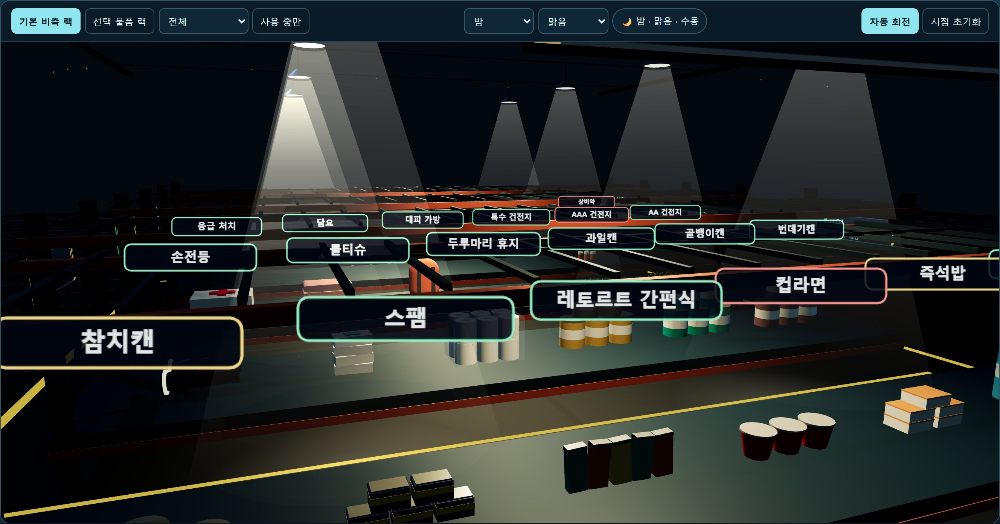
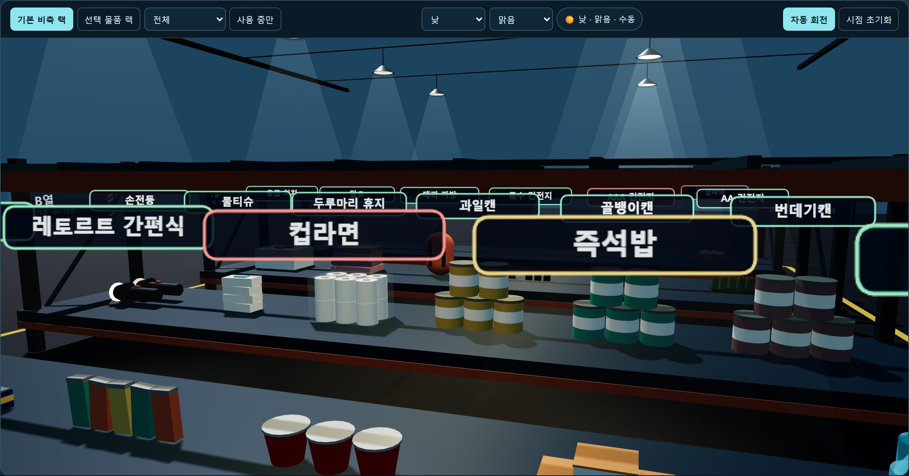

# KR Survival Kit

> **평소엔 유통기한 낭비 없는 스마트 순환 재고 관리, 비상시엔 생존 확률을 높이는 한국형 쉘터 대시보드**

  
   3D 입체 창고 · 밤 모드 (합성 데모 데이터로 촬영한 화면입니다)

생수·식량·상비약·배터리 등 가정의 비상 물품을 **버리지 않고 평소 생활 속에서 순환 소비**할 수 있도록 돕고, 정전·단수·통신 두절·민방공 경보 시 즉시 꺼내 쓸 수 있는 행동 안내와 오프라인 인쇄물을 제공하는 Home Assistant 통합입니다.

[스크린샷](#스크린샷) · [설치 방법](#설치) · [주요 기능](#주요-기능) · [비축 관리 가이드](#비축-관리) · [상황 안내와 경보음](#상황-안내와-경보음) · [프로젝트 후원하기](#후원)

---

## 왜 KR Survival Kit인가요?

- **버리는 낭비 없이 순환 소비(FIFO)**: 유통기한이 임박한 스팸·참치·즉석밥·생수를 상단 알림과 D-Day 배지로 먼저 알려주어 평소에 먹으며 자연스럽게 교체합니다.
- **게임처럼 재미있는 대비**: 시험 보는 듯한 점수 대신 **쉘터 등급(아이언~챌린저)**, **상위 % 추정 랭킹**, 그리고 지금 당장 해결할 수 있는 **긴급 퀘스트**를 하나씩 클리어하며 성취감을 느낄 수 있습니다.
- **함께 만들어 가는 오픈소스**: 품목 카탈로그·행동 안내·퀴즈가 모두 읽기 쉬운 JSON이라, 누구나 이슈나 PR로 품목 추가·문구 정정·기능 제안에 참여할 수 있습니다. ([기여 안내](CONTRIBUTING.md))

---

## 스크린샷

모든 화면은 실제 가구 재고가 아닌 **합성 데모 데이터**로 촬영했습니다.

| 3D 창고 · 눈 오는 낮 | 3D 창고 · 비 오는 밤 |
|:---:|:---:|
|  |  |
| **3D 창고 · 낮 근접 시점** | **2D 선반 대시보드** |
|  |  |

  
   ⚡ 빠른 ±1 모드 (화이트 테마) — 모달 없이 타일에서 바로 소비·보충

---

## 주요 기능

- **실시간 생존 일수 HUD**: 현재 보유한 생수와 식량으로 우리 가족이 며칠을 버틸 수 있는지(`생수 X.X일분 · 식량 X.X일분`) 상단에 실시간 표시합니다.
- **원터치 빠른 ±1 순환 소비**: `⚡ 빠른 ±1` 모드를 켜면 모달을 열지 않고 카드 위에서 바로 `−1` / `+1`로 소비·보충할 수 있습니다.
- **JSON 백업 저장/복원**: 대시보드 하단에서 내 재고 데이터를 JSON으로 백업하고 다른 기기나 새 설치에서 그대로 복원할 수 있습니다. 점수·생존 일수 계산은 별도 모듈([kr-survival-core.js](custom_components/kr_survival_kit/www/kr-survival-core.js))로 분리되어 있어 테스트하고 개선하기 쉽습니다.
- **주간 알림 자동화 Blueprint**: [weekly_rotation_alert.yaml](custom_components/kr_survival_kit/blueprints/automation/weekly_rotation_alert.yaml)을 통해 매주 유통기한 임박·부족 품목을 스마트폰으로 푸시 알림 받을 수 있습니다.
- **2D 선반 & 3D WebGL 입체 창고**: 88종 세부 품목을 88개 커스텀 SVG 아이콘이 담긴 **2D 선반**과 실제 조명·그림자·레이캐스팅 클릭·카테고리 필터가 동작하는 **3D 창고**로 오가며 관리합니다. 3D 창고는 품목마다 고유한 입체 모형(테이프 롤, 무전기, 태양광 패널, 흔들리는 촛불 등)과 천장 조명·랙 번호표를 갖추고, Home Assistant의 `sun.sun`·`weather.*` 상태를 따라 **낮/밤과 비·눈·뇌우**가 실시간으로 바뀝니다(직접 선택도 가능).
- **세부 품목 & 분산 평가**: 통조림(스팸·참치·번데기·골뱅이·과일캔), 간편식(즉석밥·컵라면·레토르트), 건전지(AA·AAA·특수), 위생(휴지·물티슈), 의료(응급처치·상비약) 등 88종을 세부 관리합니다.
- **유통기한 임박·경과 원클릭 알림**: 만료 또는 임박 품목을 상단 배너로 띄워 클릭 한 번으로 즉시 수량·날짜를 수정할 수 있습니다.
- **긴급 퀘스트 시스템**: 현재 재고 상태에서 가장 시급한 과제(만료 교체, 생수 확보, 미실사 확인 등)부터 우선 제시하고 클릭 시 바로 입력 창을 열어줍니다.
- **민방공 경보음 직접 듣기 (장치 선택 지원)**: 공습·경계·화생방·핵경보 소리를 브라우저 스피커나 집에 연결된 **Home Assistant 스마트 스피커(`media_player`)**를 골라 직접 테스트할 수 있습니다.
- **오프라인 & 인쇄 대비**: 인터넷·HA 없이도 열리는 **독립 오프라인 HTML**과 **A4 단면 한 장 행동 카드 PDF**를 제공합니다.

---

## 설치

Home Assistant 2026.11 이상에서 관리자 계정으로 설치합니다.

### 방법 1: Marketplace(HACS)로 설치 (권장)
1. Home Assistant에서 **설정 → Marketplace → 링크로 추가**로 이동합니다.
2. 저장소 주소에 `redchupa/kr_survival_kit`을 입력하고 유형을 **통합(Integration)**으로 선택해 추가합니다.
3. 다운로드 후 **Home Assistant를 재시작**합니다.
4. **설정 → 기기 및 서비스 → 통합 추가 → KR Survival Kit**를 선택해 가구 인원(기본 4명)과 점검 주기(기본 30일)를 설정합니다.
5. 왼쪽 사이드바에 **KR Survival Kit**가 나타납니다.

### 방법 2: 수동 설치
1. GitHub에서 **Code → Download ZIP**으로 저장소를 받습니다.
2. 압축을 풀고 `custom_components/kr_survival_kit` 폴더 전체(`content`, `translations`, `www` 포함)를 HA 설정 폴더의 `custom_components/` 아래에 복사합니다.
3. Home Assistant를 재시작한 뒤 위 4~5단계를 진행합니다.

---

## 비축 관리

- **2D 선반 / 3D 창고 전환**: 우측 상단 버튼으로 2D 선반과 3D 창고를 자유롭게 전환할 수 있으며, 3D 창고에서는 드래그 회전·휠 확대 및 물품 클릭 수정이 가능합니다.
- **빠른 입력 프리셋**: 품목을 클릭하면 수정 팝업이 열립니다. 생수는 `2L × 6병`, `2L × 12병`, `500ml × 20병` 버튼으로, 유통기한은 `+6개월`, `+1년`, `+2년` 버튼으로 한 번에 입력할 수 있습니다.
- **입고일 & 실사일**: 입고일을 비우면 오늘 날짜로 저장되며, 저장한 날이 마지막 실사일이 됩니다. 포장 기한을 비워 두면 품목별 확인 알림일(**포장 기한 확인일**)이 자동 등록됩니다.
- **선택 물품 검색·분류**: `선택 물품` 아래의 미사용 물품 목록에서 **카테고리 버튼**(식수·식량·취사 / 전원·연료·통신 / 의료·유아 / 방호·위생·침구 / 자산·서류·이동)과 검색창으로 필요한 물품만 골라 활성화하세요.
- **4가지 테마**: 상단에서 **블랙·화이트·블루·아이보리** 테마를 바꿀 수 있습니다. 선택은 브라우저별로 저장됩니다.

---

## 상황 안내와 경보음

**상황 안내** 탭에서 평시·경계·공습·화생방·핵경보·정전·단수별 첫 행동과 시간순 대응을 확인할 수 있습니다. 실제 상황에서는 공식 재난문자와 현장 지시를 우선하세요.

- **민방공 경보음 체험**: 출력 장치 드롭다운에서 **현재 브라우저 스피커** 또는 **집 안 HA 스마트 스피커(`media_player`)**를 선택해 4가지 경보음을 직접 들어볼 수 있습니다.
- **A4 행동 카드 & 오프라인 HTML**:
  - **A4 행동 카드 열기**: A4 한 면으로 인쇄해 냉장고나 현관에 붙여 두세요.
  - **오프라인 안내 열기**: 브라우저의 **다른 이름으로 저장**으로 보관하면 인터넷·전기가 끊겨도 열 수 있습니다.
  - HA 없이 바로 내려받기: [A4 PDF](custom_components/kr_survival_kit/www/kr-survival-kit-a4.pdf?raw=1) · [오프라인 HTML](custom_components/kr_survival_kit/www/kr-survival-kit-offline.html?raw=1)
- **상황 판단 연습**: 접이식 퀴즈를 열어 상황별 대응 지식을 점검할 수 있습니다.

---

## MQTT 센서 연결 (선택)

**설정 → 기기 및 서비스 → KR Survival Kit → 구성**에서 켤 수 있습니다. HA의 MQTT 통합과 브로커가 연결되어 있어야 하며, 부족·확인 필요·기한 임박 건수만 읽기 전용으로 발행합니다. (개인 재고 상세 내역은 외부로 발행하지 않습니다.)

---

## 업데이트와 문제 해결

- **업데이트**: 새 버전으로 업데이트한 뒤 **Home Assistant를 재시작**하고 브라우저에서 **강력 새로고침(`Ctrl + Shift + R`)**을 해 주세요.
- **설치 파일 누락**: `content/` 또는 `www/` 누락 오류가 나면 `custom_components/kr_survival_kit` 폴더 전체를 다시 복사하고 재시작하세요.
- **사이드바 메뉴 미표시**: 관리자 계정인지 확인하세요. `kr-survival-kit` 경로에 직접 만든 대시보드가 있다면 기존 대시보드 주소를 변경한 뒤 통합을 다시 로드하세요.
- **문의 및 제보 (이슈 등록)**: 설치·사용 중 불편한 점이나 새로운 품목·기능 아이디어가 있다면 [GitHub 이슈](https://github.com/redchupa/kr_survival_kit/issues/new/choose)에서 양식을 선택해 등록해 주세요. (집 주소, 연락처, 실제 보유 재고 등 개인정보는 올리지 마세요.)
- **개발자 기여 (PR 승인 운영)**: 코드 개선에 참여하고 싶다면 [CONTRIBUTING.md](CONTRIBUTING.md)를 참고해 Fork 후 Pull Request를 보내주세요. 저장소 관리자의 리뷰 및 승인(Merge)을 거쳐 반영됩니다.

---

## 후원

KR Survival Kit가 가족의 안전과 평시 알뜰한 재고 순환에 도움이 되셨다면, 작은 후원으로 지속적인 개발과 개선을 응원해 주세요. 감사합니다!

- [GitHub Sponsors](https://github.com/sponsors/redchupa)
- [PayPal](https://www.paypal.com/ncp/payment/HG9KNC262PLAC)
- 토스 앱에서 아래 QR을 스캔해 후원할 수 있습니다.

