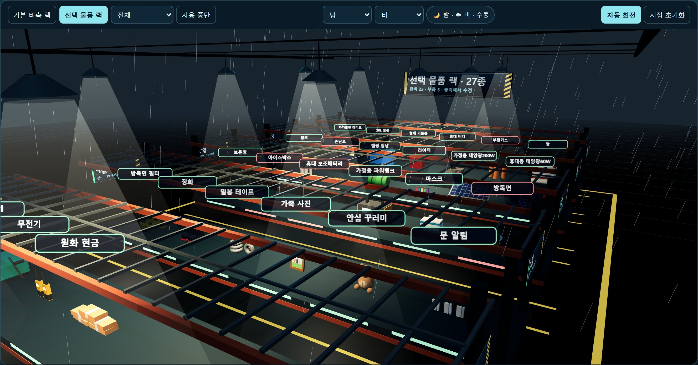

# KR Survival Kit

[한국어](README.md) | [English](README.en.md)

**비상 물품의 수량과 기한을 일상 속에서 순환 관리하고, 재난 시 행동 요령을 확인하는 Home Assistant 대시보드**

  
   3D 비축 창고 · 밤 모드

정전, 단수, 통신 두절 같은 비상 상황이 닥쳤을 때 우리 집에 며칠 치 물과 식량이 남아 있는지 한눈에 확인할 수 있습니다.

KR Survival Kit는 평소에 먹는 생수, 식량, 상비약, 배터리를 버리지 않고 유통기한 순서대로 소비하며 채워 넣도록 돕습니다. 비축 수준에 따라 쉘터 등급이 오르고, 시급한 품목을 퀘스트처럼 정리해 주며, 인터넷이 끊겼을 때를 대비한 A4 인쇄 카드와 오프라인 안내 파일도 제공합니다.

[주요 기능](#주요-기능) · [스크린샷](#스크린샷) · [설치](#설치) · [사용법](#사용법) · [자주 묻는 질문](#자주-묻는-질문) · [후원](#후원)

---

## 주요 기능

| 항목 | 설명 |
|---|---|
| **생존 가능 일수 계산** | 현재 보유한 생수와 식량으로 가구 인원 기준 며칠을 버틸 수 있는지 상단에 바로 표시합니다. |
| **유통기한 임박 알림** | 기한이 다가온 물품을 상단 배너로 먼저 알려주어 버리기 전에 소비하고 교체할 수 있습니다. |
| **약·건전지·필터 기한 관리** | 해열제·소화제·감기약, 건전지, 부탄가스, 방독면 필터 등 기한 관리가 필요한 품목의 날짜를 따로 기록합니다. |
| **세분화된 111종 품목** | 생수·즉석밥·통조림부터 소독약·멸균 거즈·헤드랜턴·보조배터리까지 품목별로 나누어 관리합니다. |
| **사용자 품목 직접 추가** | 반려동물 사료나 캠핑 장비 등 목록에 없는 물품도 이름과 단위를 정해 바로 추가할 수 있습니다. |
| **보관 위치 메모** | "현관 팬트리", "주방 상부 선반"처럼 보관 장소를 적어 두면 급할 때 바로 찾을 수 있습니다. |
| **화면 맞춤 설정 및 다크/커스텀 테마** | 제목, 집 이름, 가구 인원, 점검 주기를 바꿀 수 있으며, 블랙·화이트·블루·아이보리·사이버·로봇·공포 등 11가지 테마와 한/영 전환을 지원합니다. |
| **쉘터 등급 및 긴급 퀘스트** | 물품을 채울수록 등급(아이언~챌린저)과 추정 상위 %가 올라가며, 지금 보충할 품목을 우선순위대로 안내합니다. |
| **3D 창고 뷰** | 비축 현황을 Three.js 기반 3D 창고에서 돌려보며 확인할 수 있습니다. 연동된 날씨와 시각에 따라 낮·밤과 비·눈 효과가 적용됩니다. |
| **상황별 행동 안내 및 경보음** | 공습·경계·화생방·핵경보·정전·단수 시 첫 행동을 안내하며, 브라우저 스피커 또는 HA 미디어 플레이어로 경보음을 미리 들어볼 수 있습니다. |
| **오프라인 대비 파일** | 냉장고에 붙여 둘 A4 단면 PDF와 인터넷 없이 열리는 독립 HTML 파일을 제공합니다. |

---

## 스크린샷

| 3D 창고 · 눈 오는 낮 | 3D 창고 · 비 오는 밤 |
|:---:|:---:|
|  |  |
| **3D 창고 · 가까이 보기** | **2D 선반 화면** |
|  |  |

  
   빠른 ±1 모드 — 소비하거나 보충할 때 모달 없이 버튼 한 번으로 수량 변경

---

## 설치

Home Assistant 2026.11 이상 및 관리자 계정이 필요합니다.

### HACS로 설치 (권장)

아래 버튼을 누르면 내 Home Assistant의 HACS에서 이 저장소가 바로 열립니다. URL을 복사해 붙여넣을 필요가 없어요.

버튼이 동작하지 않으면 아래 순서대로 진행하세요.

1. Home Assistant에서 **HACS**를 엽니다.
2. **KR Survival Kit**를 검색해 선택합니다.
3. **다운로드**를 누른 뒤 Home Assistant를 재시작합니다.
4. **설정 → 기기 및 서비스 → 통합 추가 → KR Survival Kit**를 선택하고 가구 인원과 기본 점검 주기를 입력합니다.
5. 왼쪽 사이드바에 **KR Survival Kit** 메뉴가 추가됩니다.

HACS 검색 결과에 보이지 않는 경우

HACS 우측 상단 메뉴에서 **사용자 지정 저장소(Custom repositories)**를 열고 저장소 주소 `https://github.com/redchupa/kr_survival_kit`을 입력한 뒤, 유형을 **통합(Integration)**으로 선택해 추가하세요. 이후 위 3단계부터 진행하면 됩니다.

수동 설치

1. 저장소 상단의 **Code → Download ZIP**으로 압축 파일을 내려받습니다.
2. 압축을 푼 뒤 `custom_components/kr_survival_kit` 폴더 전체(`content`, `translations`, `www`, `blueprints` 포함)를 Home Assistant 설정 폴더의 `custom_components/` 아래에 복사합니다.
3. Home Assistant를 재시작하고 위 4~5단계를 진행합니다.

---

## 사용법

1. **품목 입력**: 카드를 클릭해 보유 수량과 유통기한을 입력하고 저장합니다. 생수의 `2L × 12병`, 날짜의 `+1년` 같은 빠른 입력 버튼을 활용하면 편리합니다.
2. **빠른 수량 조절**: 일상에서 꺼내 먹거나 새로 사 왔을 때는 선반 상단의 **빠른 ±1** 모드를 켜서 버튼 한 번으로 수량을 증감할 수 있습니다.
3. **임박 품목 순환**: 상단에 기한 임박 알림이 뜨면 해당 품목을 먼저 소비한 뒤 새 날짜로 교체하세요.
4. **목록에 없는 품목**: `선택 물품` 섹션의 **+ 물품 직접 추가** 버튼을 눌러 원하는 품목을 자유롭게 등록할 수 있습니다.
5. **설정 및 테마/언어**: 우측 상단 설정 버튼으로 대시보드 제목·집 이름·가구 인원·표시 항목을 바꿀 수 있고, 패널 상단 바에서 11가지 테마와 한국어/영어(`KO / EN`)를 전환할 수 있습니다.
6. **비상 시**: 상단 메뉴의 **상황 안내** 탭에서 경보별 첫 행동과 오프라인 인쇄물을 확인하세요. 실제 재난 시에는 공식 재난문자와 현장 지시를 우선해야 합니다.

> HA 없이 파일만 바로 받으려면: [A4 PDF](custom_components/kr_survival_kit/www/kr-survival-kit-a4.pdf?raw=1) · [오프라인 HTML](custom_components/kr_survival_kit/www/kr-survival-kit-offline.html?raw=1)

---

## 자주 묻는 질문

업데이트했는데 화면이 바뀌지 않습니다.

Home Assistant를 재시작한 뒤 브라우저에서 **Ctrl + Shift + R**(강력 새로고침)을 눌러 캐시를 비워 주세요.

왼쪽 사이드바에 메뉴가 보이지 않습니다.

관리자 계정으로 로그인했는지 확인하세요. 이미 `kr-survival-kit` 경로로 직접 만든 대시보드가 있다면 기존 대시보드 주소를 변경한 뒤 통합을 다시 로드하세요.

재고 기록을 다른 기기로 옮기고 싶습니다.

화면 아래의 **재고 백업 저장 (JSON)**으로 파일을 내려받은 뒤, 새 환경에서 **백업 복원**을 눌러 파일을 선택하면 직접 추가한 품목과 보관 위치까지 함께 복원됩니다.

설치 후 가구 인원이나 점검 주기를 바꾸고 싶습니다.

대시보드 우측 상단의 설정 버튼이나 **설정 → 기기 및 서비스 → KR Survival Kit → 구성**에서 언제든 수정할 수 있습니다.

MQTT 옵션은 꼭 켜야 하나요?

아닙니다. 통합 설치 시 Home Assistant 내부에 `부족한 품목`, `확인할 품목`, `기한 임박 품목` 센서 3개가 기본 생성되므로 일반 자동화에는 이 센서들을 그대로 쓰면 됩니다. 외부 시스템(Node-RED 등)으로 집계 숫자만 연동하고 싶을 때만 선택적으로 켜세요.

매주 정기적으로 알림을 받고 싶습니다.

포함된 [주간 알림 블루프린트](custom_components/kr_survival_kit/blueprints/automation/weekly_rotation_alert.yaml)를 가져와 센서 3개와 알림을 받을 모바일 앱 기기를 지정하면 매주 설정한 요일에 푸시 알림을 받을 수 있습니다.

내 재고 데이터가 외부로 전송되나요?

전송되지 않습니다. 모든 재고 기록은 로컬 Home Assistant 저장소(`Store`)에만 보관됩니다.

버그 제보나 기능 제안은 [GitHub 이슈](https://github.com/redchupa/kr_survival_kit/issues/new/choose)를 이용해 주세요. (주소, 연락처, 실제 보유 재고 등 개인정보는 올리지 마세요.) 코드 기여 절차는 [CONTRIBUTING.md](CONTRIBUTING.md)를 참고해 주세요.

---

## 후원

이 프로젝트가 도움이 되었다면 아래 경로로 개발 및 유지보수를 응원해 주실 수 있습니다.

- [GitHub Sponsors](https://github.com/sponsors/redchupa)
- [PayPal](https://www.paypal.com/ncp/payment/HG9KNC262PLAC)
- 토스 앱에서 아래 QR 코드를 스캔해 후원할 수 있습니다.

