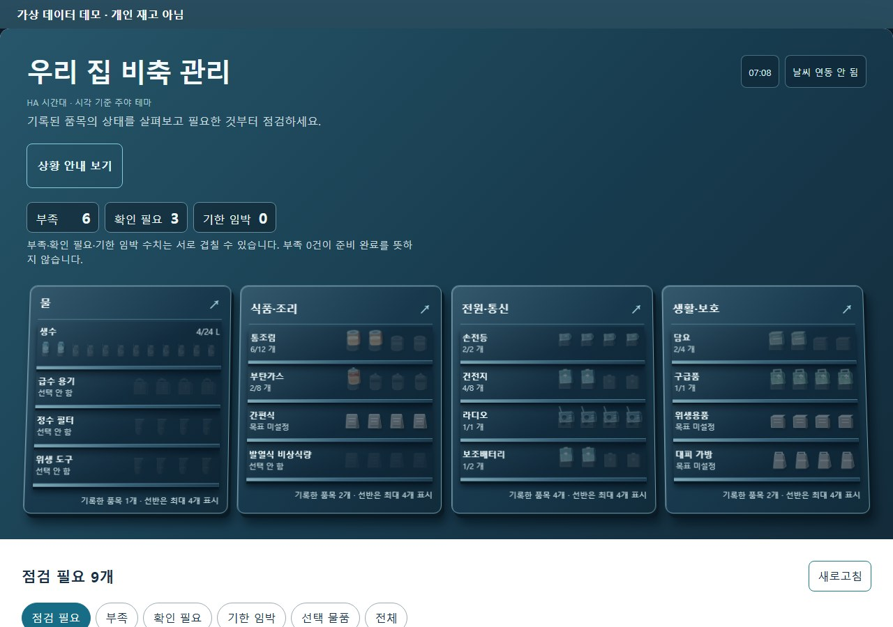

# KR Survival Kit

평소 쓰는 물품으로 준비하고, 정전이 나면 미리 저장하거나 인쇄한 안내를 꺼내 쓰는 한국 가정 비상 대비 프로젝트입니다.

이 저장소는 **공개 소스 프리뷰**입니다. 행동 안내와 퀴즈는 `0.1.0-draft.12`이며 독립적인 사람 검토 전입니다. 정식 HACS 안정 릴리스로 표시하지 않습니다.

**[최신 작업 상태와 다음 단계](docs/current-status.ko.md)** · 이전 단계별 기록은 이 README 아래에 보존했습니다.

재고의 기본 **30일은 점검 주기**입니다. 식품·생수·부탄캔을 포함한 56개 품목의 실제 소비·사용·교체 기한은 구매한 제품마다 다릅니다. 구매 단위별 입고일과 포장 표시 기한을 기록하면 남은 날을 볼 수 있고, 품목별 점검 주기를 바꿀 수 있습니다. 입고일만으로 확정 소비기한을 만들지 않습니다.

현재 2D 화면에는 **완비한 품목만 그림으로 나타나는 명부**, 네 분야의 기록 미션과 준비 단계, 공식 안내를 바탕으로 만든 8문항 학습 퀴즈가 있습니다. 단계와 정답 수는 재고 기록·학습 상태이며 생존 확률을 뜻하지 않습니다. 퀴즈 응답 ID는 사용 중인 브라우저에만 저장합니다.



*화면 예시는 합성 재고입니다. 실제 가족 재고나 위치 정보는 포함하지 않습니다.*

**인쇄해서 쓰기** · `output/pdf/kr-survival-kit-a4.pdf`는 A4 단면 한 장입니다. 전화·인터넷 두절, 경보별 첫 행동, 4인 가구 3일 준비량 요약, 대피 후 점검과 가족 기록칸을 같은 면에 배치했습니다. 상세 타임라인·상황별 전환표·품목별 준비량과 근거는 `output/offline.html` 파일을 저장해 인터넷 없이 읽을 수 있습니다.

**Home Assistant로 시작하기** · `output/dashboard.yaml`은 비축 관리와 상황 안내를 각각 전체 폭 카드로 구성합니다. 상황 안내에서 경보 종류를 선택해 첫 행동을 확인하고, 시간순 행동요령과 인쇄·오프라인 자료를 엽니다. PDF·HTML 버튼은 파일을 여는 동작이며 열린 브라우저의 인쇄·다운로드·저장 기능으로 기기에 보관합니다. 로컬 재고와 집계 센서, 선택형 MQTT Discovery를 사용할 수 있습니다.

현재 자료는 **공개 프리뷰 초안**입니다. 공습·평시 준비, 경계·화생방·핵경보, 정전·단수 안내를 담았습니다. 현재 발령된 재난문자·방송과 현장 지시를 먼저 따르세요. 전화·인터넷이 끊긴 경우를 첫 화면과 인쇄물 상단에 따로 안내합니다. 가족 연락처와 실제 대피소 정보는 인쇄한 공란에 손으로 적어 개인 보관하세요.

## 로컬에서 만들기

Python 3.11 이상에서 저장소 루트 기준으로 실행합니다. HTML과 HA Markdown 빌드에는 Python 표준 라이브러리만 필요합니다.

```text
python scripts/build_guides.py
python -m unittest discover -s tests -p test_guides.py -v
python tests/test_household.py
```

PDF와 브라우저 검증에는 개발 의존성, Chromium, 시스템 한글 글꼴이 필요합니다. Windows에서는 맑은 고딕을 사용할 수 있습니다. Linux에서는 Noto Sans CJK KR을 설치한 뒤 실행하세요.

```text
python -m pip install -r requirements-dev.txt
python -m playwright install chromium
python scripts/build_guides.py --pdf
python tests/verify_artifacts.py
```

이미 설치한 Chrome을 쓰려면 마지막 두 명령에 `--browser "<Chrome 실행 파일의 절대 경로>"`를 붙이세요. 출력물은 Git에서 제외하며 릴리스 단계에서 별도 아티팩트로 배포합니다. Markdown 카드에서 읽을 때는 생성된 Markdown 내용을 붙여넣고, 오프라인 파일은 비상 전에 기기에 저장해 두세요.

## 콘텐츠와 공개 검토

- `custom_components/kr_survival_kit/content/guide.ko.json`은 통신 두절과 상황별 안내의 단일 원본입니다. 각 상황에 안정 ID, 첫 행동, 상세 행동, 종이용 요약, 출처 ID, 검토 상태와 검토일이 있습니다. 출처에는 기관, 제목, URL, 확인한 문단, 확인일이 있습니다. [상황별 근거와 예외 검토표](docs/content-review.md)에서 인쇄 문구의 근거를 확인할 수 있습니다.
- `catalog.ko.json`은 브랜드와 구매 링크가 없는 56개 품목의 목록입니다. 기존 55개에 발열식량을 추가했습니다. 선택 물품은 총 45개이며 기본 준비량과 구분합니다. 우선순위는 평소 소비(`rotation`), 보유 장비 점검(`owned`), 해당 가구 준비(`household`), 선택 추가(`optional`) 순입니다. 수량 단위와 `소비기한`·`교체 점검일` 같은 날짜 표시는 품목별로 다릅니다. 품목별 목표량은 가구가 정합니다. [원본 항목 대응표](docs/v4-item-mapping.ko.md)와 [기한 기록 안내](docs/rotation-and-expiry.ko.md)에 판단 근거를 기록했습니다.
- 실제 사람·주소·연락처·동선을 자료나 제보에 포함하지 마세요. `tests/fixtures/stock.json`의 값은 검증용 가상 수량입니다.
- 출처나 행동 문구를 바꾸면 문구를 `draft`로 돌리고 `reviewed_on`을 비웁니다. 공개 전 검토자가 출처와 문장을 대조한 뒤 `reviewed`와 검토일을 기록하고 안내 버전을 올립니다. `python scripts/build_guides.py --release --pdf`는 미검토 문구 또는 초안 버전에서 실패합니다.

## P2 로컬 재고와 Home Assistant

`custom_components/kr_survival_kit/`를 HA 설정 폴더의 `custom_components/`에 복사하고 HA를 재시작한 뒤 **설정 → 기기 및 서비스 → 통합 추가 → KR Survival Kit**를 선택합니다. 한 인스턴스에 한 가구만 등록합니다. **기본 재고 점검 주기 (일)**를 정하면 실사 후 다시 확인할 시점을 계산합니다. 기본값은 30일이며, 제품 소비기한과 별개입니다. 설정을 마치면 로컬 `Store`에 버전 1 스냅샷을 저장합니다. 브로커나 외부 계정은 필요하지 않습니다. 운영 설치 결과는 아래 [NRGNC 운영 검증](#nrgnc-운영-검증-2026-11-11)에 기록했습니다.

설정이 끝나면 관리자 계정의 사이드바에 **KR Survival Kit**가 자동으로 나타납니다. **비축 관리**와 **상황 안내**를 열 수 있고, A4 행동 카드와 오프라인 안내도 통합에 포함됩니다. 비축 선반에는 기본 및 활성화한 물품의 그림과 현재량·목표량을 표시합니다. 그림이나 수량을 눌러 품목을 바로 수정하고, 저장하거나 취소하면 원래 품목으로 돌아갑니다. 마지막 실사가 확인되지 않으면 **실사 필요**가 표시됩니다. 선택 물품 선반에는 사용 중인 품목을 먼저 표시하고, 아래에서 미사용 품목을 펼쳐 설정할 수 있습니다. 비축 점수는 기본품별 목표 달성률을 같은 비중으로 합산해 100점으로 표시합니다. 최근에 실사했고 기한이 충분한 재고만 반영하며 선택 물품과 퀴즈 점수는 별도입니다. 10점 단위로 아이언부터 챌린저까지 등급이 올라갑니다. 상황 판단 연습은 **상황 안내**에서 열 수 있습니다. 기존 설치는 전체 통합 폴더를 업데이트하고 Home Assistant를 재시작하면 됩니다. 같은 `kr-survival-kit` 주소에 직접 만든 대시보드가 있으면 해당 화면이 우선합니다. 자동 패널로 전환하려면 기존 대시보드의 주소를 변경한 다음 통합을 다시 로드하세요.


수동 설치는 GitHub의 **Code → Download ZIP**으로 전체 저장소를 받은 뒤 `custom_components/kr_survival_kit/` 폴더 전체를 복사하세요. 이 폴더 안의 `content/`와 `translations/`도 포함해야 합니다. `catalog.ko.json` 누락으로 초기화에 실패했다면 그 폴더 전체를 다시 복사하고 HA를 재시작하세요. 기존에 등록한 통합은 재시작 시 다시 로드됩니다.


관리자는 개발자 도구의 action 또는 대시보드 재고 카드에서 `kr_survival_kit.get_inventory`를 호출해 `revision`, 품목별 `state`와 합계를 읽을 수 있습니다. `kr_survival_kit.set_item`은 **현재 revision**과 카탈로그 `item_id`, `applicable`, `target`, `lots`, `confirm`을 요구합니다. `lots`의 각 원소는 `lot_id`, 비음수 정수 `quantity`, ISO 날짜 또는 `null`인 `expires_on`을 가집니다. `kr_survival_kit.delete_item`은 `item_id`와 현재 revision을 요구합니다. 성공한 쓰기는 새 revision을 반환하며, 다른 편집이 먼저 저장되면 다시 조회한 뒤 절대 수량으로 재입력해야 합니다. 이 action들은 HA 관리자만 호출할 수 있습니다. `entry_id`는 단일 가구에서 생략할 수 있습니다.

예시: 첫 `get_inventory`가 `revision: 0`을 반환했다면 아래처럼 **실제로 확인한 뒤에만** `confirm: true`로 저장합니다. `target`과 `quantity`의 단위는 카탈로그 품목 단위(`ml` 또는 `개`)입니다.

```yaml
action: kr_survival_kit.set_item
data:
  item_id: drinking-water
  revision: 0
  applicable: true
  target: 5000
  lots:
    - lot_id: bottles-1
      quantity: 2000
      expires_on: "2027-02-01"
  confirm: true
```

확인한 0개는 `부족`, 미기록·목표 미설정·실사 경과·확인하지 않은 수정은 `확인 필요`입니다. 해당 없음과 목표 0은 집계에서 제외합니다. 표시 기한이 지난 수량은 사용 가능 수량에서 제외하고 날짜 미상 수량은 확정 수량에 포함하지 않습니다. 기한 임박은 오늘부터 30일 이내에 표시 기한이 있는 품목 수이며 부족 여부와 독립적입니다. 표시 기한 당일은 집계하고 다음 날 제외합니다. 식품의 실제 사용 가능성은 포장과 보관 상태를 별도로 확인해야 합니다. 센서의 엔터티 ID는 HA가 정하므로 `unique_id`의 끝인 `shortage_count`, `needs_check_count`, `expiring_count`로 확인하세요. 현지 날짜가 바뀌면 센서를 다시 계산합니다.

### P2 검증 결과 (2026-11-09)

- Windows Python 3.14에서 `PYTEST_DISABLE_PLUGIN_AUTOLOAD=1`과 `pytest_asyncio.plugin`을 사용한 순수 재고 테스트: **6개 통과**. 확인한 0개와 미기록, 기한 경과·미상, 자정, 실사 경과, 해당 없음, 삭제, 비확인 수정, 동시 revision 충돌, 저장 실패 후 스냅샷·알림 유지, 저장본 재로드, 지원하지 않는 스키마의 쓰기 방지를 검사했습니다. 기존 P0–P1 `unittest` 8개도 통과했습니다.
- 격리된 WSL Ubuntu 24.04, Python 3.14.10, **Home Assistant Core 2026.11.0**에서 `tests/ha_smoke.py` 통과. 실제 HA 설정 흐름으로 통합을 추가하고 브로커 없이 집계 센서 3개를 생성했습니다. 관리자 action으로 저장 후 센서가 갱신되었고, 오래된 revision·비관리자 조회·강제 저장 실패는 거부되었습니다. HA 인스턴스를 중지하고 같은 설정 디렉터리에서 새 인스턴스를 시작해 revision, 목표량, 부족 센서 값이 복원됨을 확인했습니다. 테스트 HA의 선택적 FFmpeg/터보JPEG 의존성 경고는 이 통합 검증의 실패가 아니었습니다.
- 재현 명령(저장소 `public/`에서): Windows PowerShell은 `$env:PYTEST_DISABLE_PLUGIN_AUTOLOAD='1'; py -3.14 -m pytest -q tests/test_inventory.py -p pytest_asyncio.plugin`; Linux/WSL의 격리 Python 환경(`homeassistant==2026.11.0`)은 `python tests/ha_smoke.py`입니다. Windows의 HA 테스트 플러그인은 `fcntl`을 요구하므로 실제 HA 검증은 WSL에서 실행했습니다.

## P3 선택형 MQTT 센서

**설정 → 기기 및 서비스 → KR Survival Kit → 구성**에서 MQTT 센서 발행을 켤 수 있습니다. 기존 HA MQTT 통합이 브로커에 연결되어 있어야 합니다. 이 옵션의 기본값은 꺼짐입니다. HA MQTT 통합에서 설정한 Discovery prefix를 사용하며, birth 메시지 설정은 그대로 둡니다. 연결 상태 알림으로 재연결을 감지합니다.

세 센서는 `shortage_count`, `needs_check_count`, `expiring_count`의 숫자만 전송합니다. Discovery 설정은 retained QoS 1, 상태는 non-retained QoS 1입니다. 연결·재연결 때 최신 스냅샷을 보내고, 이후 재고 변경 직후와 60초 간격으로 전송합니다. 상태 메시지가 180초 동안 없으면 MQTT 센서는 unavailable이 됩니다. 센서 상태는 비상 경보나 대피 판단에 사용하지 마세요.

발행을 끄면 retained Discovery 설정 3개를 빈 메시지로 지웁니다. 브로커가 끊겼다면 `mqtt_cleanup_pending` 옵션이 남고 연결 복구 후 다시 정리합니다. 통합을 제거할 때 브로커가 끊겨 정리에 실패했다면 브로커 관리자에서 아래 패턴의 retained 토픽 3개를 삭제하세요. `<prefix>`는 HA MQTT 통합의 Discovery prefix이고 `<entry_id>`는 이 통합의 config entry ID입니다.

```text
<prefix>/sensor/kr_survival_kit_<entry_id>/shortage_count/config
<prefix>/sensor/kr_survival_kit_<entry_id>/needs_check_count/config
<prefix>/sensor/kr_survival_kit_<entry_id>/expiring_count/config
```

### P3 검증 결과 (2026-11-10)

- 격리된 WSL Ubuntu 24.04의 **HA Core 2026.11.0**과 실제 **Mosquitto 2.0.18**에서 `tests/ha_mqtt_smoke.py` 통과. MQTT 통합의 UI 설정 흐름을 사용해 브로커를 연결하고, KR Survival Kit 옵션 흐름으로 발행을 켰습니다. 새 구독자에게 retained Discovery 3개가 전달되고 상태 메시지는 보존되지 않는 것을 확인했습니다.
- 실제 MQTT 센서 3개가 생성되었고, 테스트에서 만료 시간을 3초로 낮춰 unavailable 전환과 새 상태 발행 후 숫자 복구를 확인했습니다. 상태를 중복 발행해도 metric별 엔터티는 하나씩 유지됐습니다. 제품 설정은 180초 만료·60초 재발행입니다.
- 브로커 종료 중 관리자 action으로 재고를 저장했습니다. 브로커 재시작 뒤 최신 부족 건수 1이 발행됐고, HA 인스턴스 재시작 후에도 재고 revision과 발행이 복원됐습니다. 브로커를 다시 중단한 상태에서 발행을 끄자 정리 대기가 기록됐으며, 재연결 후 빈 retained Discovery 메시지 3개가 발행되고 정리 대기가 해제됐습니다. 새 구독자는 삭제된 Discovery를 받지 않았습니다. 브로커 단절 직후 HA MQTT 자체의 birth 발행 실패 로그가 발생했으나 이후 복구됐습니다.
- 재현은 Linux/WSL의 격리 Python에 `homeassistant==2026.11.0`과 HA MQTT 통합 요구사항인 `paho-mqtt==2.1.0`, 실행 파일 `mosquitto`가 필요합니다. `public/`에서 `python tests/ha_mqtt_smoke.py`를 실행합니다. 테스트는 임시 HA 설정과 별도 포트 18885의 브로커를 생성하고 종료합니다. P2 회귀 테스트 6개와 기존 안내 테스트 8개도 통과했습니다.

## P4 Home Assistant 대시보드 설치

`public/`에서 안내와 대시보드를 생성합니다. PDF 생성에는 앞 절의 Playwright와 Chromium이 필요합니다.

```text
python scripts/build_guides.py --pdf
python scripts/build_dashboard.py
```

위 자동 사이드바에서 카드와 인쇄 자료가 함께 열립니다. 직접 편집하는 별도의 Lovelace 대시보드를 구성하는 경우에만 아래의 수동 설치를 사용하세요. 정적 파일 경로는 인증 없이 열리므로 가구 재고나 연락처를 넣지 마세요.

| 원본 | HA 설정 폴더의 목적지 |
| --- | --- |
| `custom_components/kr_survival_kit/www/kr-survival-kit-card.js` | `www/kr-survival-kit-card.js` |
| `output/pdf/kr-survival-kit-a4.pdf` | `www/kr-survival-kit-a4.pdf` |
| `output/offline.html` | `www/kr-survival-kit-offline.html` |

**설정 → 대시보드**에서 `KR Survival Kit` 대시보드를 만들고 URL을 `kr-survival-kit`으로 지정합니다. 리소스 `/local/kr-survival-kit-card.js`를 JavaScript 모듈로 등록하고, 대시보드의 원시 설정 편집기에 `output/dashboard.yaml` 내용을 붙여 넣습니다. 첫 보기의 카드 안에 있는 **상황 안내** 링크는 두 번째 보기로 연결됩니다. 다른 대시보드 URL을 쓴다면 `output/dashboard.yaml`의 `/kr-survival-kit/guide`와 카드 JS의 `/kr-survival-kit/home`도 맞춰 수정하세요. 집계 수치는 카드가 재고 응답에서 표시합니다. 두 번째 보기의 **A4 행동 카드 열기**와 **오프라인 안내 열기**는 `/local/kr-survival-kit-a4.pdf`, `/local/kr-survival-kit-offline.html`을 엽니다. PDF는 열린 화면에서 인쇄하거나 다운로드하고, HTML은 브라우저의 다른 이름으로 저장을 사용해 비상 전에 기기에 보관하세요.

비축 관리 상단에서 가구 인원을 변경할 수 있습니다. 기본값은 **4인**입니다. 3일치 생수 권장량은 **1인당 6 L**로 계산하며, 4인 24 L에서 2인 12 L로 바뀝니다. 배낭과 담요는 인원수에 맞추고, 손전등과 구급함은 가구 공용 기준을 적용합니다. 직접 저장한 품목별 목표는 자동 권장량보다 우선합니다.

- **생수**는 병 하나의 용량과 병 수를 입력합니다. 예를 들어 `2 L` 병 `12개`를 입력하면 `총 24 L`로 계산됩니다. 이전에 총량만 입력한 기록은 저장된 L를 그대로 표시합니다.
- **다른 물품**은 수량을 입력하고, 필요할 때 포장에 적힌 **소비기한 또는 유통기한**, 입고일을 기록합니다. 보관 묶음 이름은 자동으로 붙습니다. 실사 체크박스를 선택했을 때만 오늘을 마지막 실사일로 기록합니다.
- 재고 카드의 관리자 action은 `get_inventory`, `set_item`, `delete_item`, `set_household_size`입니다. 동시 수정이 발생하면 최신 revision을 읽고 입력을 유지한 채 재확인을 요청합니다. 저장 실패도 입력을 유지하며, MQTT 연결과 별개로 재고를 관리합니다.


날씨를 표시하려면 생성된 대시보드의 첫 번째 카드에 **실제 가구와 같은 지역**의 HA 날씨 엔터티를 직접 지정합니다. 지정하지 않으면 `날씨 연동 안 됨`으로 표시합니다. 관측 갱신이 지연되거나 엔터티가 unavailable이면 날씨를 추측하지 않습니다.

```yaml
type: custom:kr-survival-kit-inventory-card
guide_path: /kr-survival-kit/guide
weather_entity: weather.your_local_area
```

### P4 검증 결과 (2026-11-10)

- 격리된 HA Core 2026.11.0의 실제 대시보드에서 Markdown 안내, Tile 집계, 사용자 정의 재고 카드가 렌더링됐습니다. 375px 화면에서 안내와 인쇄 링크를 찾고, **상황별 행동요령 열기**에서 별도 보기로 이동해 행동요령 본문을 확인했습니다. 관리자 계정으로 생수 목표량·구매 단위 수량·표시 기한을 저장해 화면에 반영되는 것을 확인했습니다. PDF와 오프라인 HTML은 HA의 `/local`에서 각각 HTTP 200으로 열렸습니다.
- 200% 확대에서 Tile 텍스트가 잘리는 문제를 발견해 Tile을 한 줄 너비로 바꾼 뒤 다시 확인했습니다. Tab과 Enter로 재고 편집과 구매 단위 추가가 가능했습니다. 밝은 테마와 어두운 테마를 화면으로 확인했습니다. 어두운 테마의 상태 색상 대비를 조정했습니다.
- 카드가 편집 중일 때 다른 관리자 action으로 revision을 먼저 변경한 시험에서 충돌 안내와 입력 보존을 확인했습니다. 저장 실패를 흉내 낸 카드 시험에서도 입력이 유지됐고 이후 다시 저장할 수 있었습니다. 격리 HA에는 MQTT 통합을 설정하지 않았으며 재고 조회와 수정이 작동했습니다. 실제 휴대전화와 실물 프린터 검증은 P5에서 수행해야 합니다.

### P4에서 P5로 넘긴 항목

P4에서 넘긴 깨끗한 HA 설치·업데이트·삭제는 P5의 격리 HA에서 확인했습니다. 운영 HA 적용 결과는 아래에 기록했습니다. 실제 휴대전화와 프린터로 5분 탁상훈련을 진행하고, 공개 전에는 가족 원본이나 개인 재고가 Git 히스토리·릴리스 파일·화면 캡처에 없는지 검사해야 합니다. 공습·정전 등 행동 문구의 출처와 `draft` 상태도 다른 사람이 다시 검토해야 합니다. GitHub 게시는 이 검증 이후에 진행합니다.

2026-11-18 개편 검증. 격리 HA Core 2026.2.3에서 4인 초기값, 5인 변경·재시작 후 복원, 직접 지정한 생수 목표 유지, 기존 총량 복원, 동시 저장 충돌 및 저장 실패를 확인했습니다. Chromium 가상 재고 화면에서 `2 L × 12병 = 24 L`, 저장값 `24000 ml`, 375px 및 CSS 확대 200% 가로 넘침 여부를 확인했습니다. 이 개편의 운영 HA 화면 검증은 대기 중입니다.

## P5 공개 프리뷰 후보 (2026-11-10)

격리 HA에서 새 설치·P4 설치본 업데이트·삭제를 확인했습니다. 실제 브로커를 끊은 대시보드에서 가상 생수 재고의 조회와 수정도 통과했습니다. 재현 명령과 검증 범위는 [P5 검증 기록](docs/p5-validation.md)에 있습니다.

HACS용 `hacs.json`, MIT `LICENSE`, [변경 이력](CHANGELOG.md), [보안·안내 정정 제보 경로](SECURITY.md), [릴리스 초안](docs/release-draft.md)을 준비했습니다. `public/`이 Git 저장소 루트이며, HACS가 설치하는 코드는 `custom_components/kr_survival_kit/`에 있습니다. PDF·오프라인 HTML·대시보드 생성물은 릴리스 자산으로 따로 제공할 예정입니다. `python scripts/audit_public.py`는 Git 전체 이력과 공개 후보의 개인정보 형식을 검사합니다.

`python scripts/build_candidate.py`는 현재 초안 PDF·HTML·대시보드·카드와 SHA256 목록을 `output/release-candidate/`에 모읍니다. 이 폴더에는 공개 보류 표기가 있으며 검토 후 다시 생성해야 합니다. GitHub CI는 안내 단위 테스트, 생성기, `python tests/check_package.py` 및 개인정보 형식 검사를 실행합니다. 일치 항목을 발견하면 검사 단계가 실패합니다. 재고 테스트와 HA 통합 테스트의 실행 방법은 P2와 P5 검증 기록에 있습니다.

**공개 차단** · 행동 문구를 공식 원문과 1차 대조했습니다. 독립 검토와 `draft` 해제, 실물 휴대전화·흑백 A4 탁상훈련, 최종 릴리스 자산 및 화면 캡처의 개인정보 재검사가 남았습니다. 현재 원격 Git 저장소가 없어 HACS 사용자 지정 저장소 설치와 Home Assistant Brands 등록도 확인하지 못했습니다. [문구 대조표](docs/content-review.md) · [P5 검증 기록](docs/p5-validation.md)

## NRGNC 운영 검증 (2026-11-10)

Home Assistant OS의 **Core 2026.11.1**에서 `custom_components/kr_survival_kit/`와 공개 정적 파일 3개를 설치하고, 관리자 전용 `kr-survival-kit` 대시보드의 `home`·`guide` 보기를 갱신했습니다. 통합 manifest 버전은 `0.1.0`이고 안내 콘텐츠와 PDF·HTML 버전은 **`0.1.0-draft.7`**입니다. 기존 집계 센서 3개의 entity ID, 다른 대시보드와 카드 리소스는 유지했습니다. MQTT 발행 설정과 브로커는 변경하지 않았습니다.

- 배포 전 통합·정적 파일·전용 대시보드·리소스를 백업했습니다. HA 설정 검사는 `valid`였고 재시작 후 통합은 `loaded`입니다. 관리자 `get_inventory` 응답에 4인·3일 권장량 `household`가 들어 있으며, 기존 개인 재고 스냅샷·목표·revision은 배포 전후 동일했습니다. 실제 재고는 시험용으로 수정하지 않았습니다. 통합의 동기 파일 읽기 경고는 재시작 후 시스템 로그에서 재발하지 않았습니다.
- 서버의 별도 staging에서 안내 `unittest` **10개**, 가구 권장량 검사 **1개**, 격리 venv의 순수 재고 회귀 테스트 **6개**가 통과했습니다. 이 테스트들은 운영 HA의 저장소나 실제 재고를 사용하지 않았습니다.
- `/local/kr-survival-kit-card.js`, `/local/kr-survival-kit-a4.pdf`, `/local/kr-survival-kit-offline.html`을 실제 HTTP GET으로 확인했습니다. 세 응답은 HTTP 200이고 SHA256은 배포 후보와 일치합니다. PDF는 A4 한 쪽이며 PDF·HTML 모두 `0.1.0-draft.7`과 4인 예시의 음용수 24 L, 전체 안전수 약 46 L, 식품 합계 36인분을 담고 있습니다. HTML에는 7일·14일 확장량도 있습니다.
- 대시보드 설정을 다시 읽어 첫 화면에서 초안 버전과 반복 외부 출처를 표시하지 않는 것, 내장 버튼 2개의 PDF·HTML URL, 4인 요약과 단위, 관리자 카드와 집계 센서 3개, 안내 보기의 출처 카드 1개 및 중복 없는 외부 URL을 확인했습니다. **인증된 실제 브라우저에서 버튼 클릭·375px 렌더링은 검증하지 못했습니다.** 실물 휴대전화와 프린터의 탁상훈련도 남아 있습니다.

## NRGNC 운영 검증 (2026-11-11)

Home Assistant OS의 **Core 2026.11.1**에서 안내 콘텐츠 **`0.1.0-draft.8`**을 설치했습니다. 통합 manifest 버전은 계속 `0.1.0`입니다. 기존 통합·정적 파일·전용 대시보드·리소스와 재고 저장 파일을 운영 서버의 비공개 위치에 백업한 뒤, 통합의 공개 카탈로그·안내와 정적 파일 3개만 교체했습니다. 설정 검사는 `valid`였으며 전체 HA 재시작 없이 해당 통합을 다시 로드했습니다. 전용 `kr-survival-kit` 대시보드와 기존 카드 리소스 URL만 갱신했고, 다른 대시보드·브로커 설정은 변경하지 않았습니다.

- 운영 `get_inventory`에서 카탈로그 **55개**(기존 13개에서 신규 선택 물품 42개 추가), `household` 응답, 기존 재고 `revision`·품목·목표 불변을 확인했습니다. 저장 파일의 SHA256도 배포 전후 같고 실제 재고를 수정하지 않았습니다. 집계 센서 3개의 entity ID와 상태를 확인했으며 통합 관련 시스템 로그에 새 경고가 없었습니다.
- 운영 서버의 분리된 staging에서 안내 `unittest` **12개**, 가구 권장량 검사 **2개**, 격리 venv의 순수 재고 회귀 테스트 **6개**, 총 **20개**가 통과했습니다. 운영 저장소나 개인 재고를 테스트에 사용하지 않았습니다.
- 실제 HTTP GET에서 `/local/kr-survival-kit-card.js`, `/local/kr-survival-kit-a4.pdf`, `/local/kr-survival-kit-offline.html`이 모두 HTTP 200이고 최종 후보 SHA256과 일치했습니다. PDF는 후보와 동일한 A4 단면 한 쪽이고 PDF·HTML의 안내 버전은 `0.1.0-draft.8`입니다. HTML은 4인 권장량과 7일·14일 확장량을 담습니다.
- 전용 대시보드 설정을 API로 다시 읽어 후보의 `home`·`guide` 보기와 일치함을 확인했습니다. 카드 리소스 URL은 최종 JS 해시를 가리킵니다. 인증된 실제 브라우저의 어두운 테마·375px 화면에서 안내 제목 중복이 없는 것, 첫 화면 준비량 요약 1회, 선택 물품 44개 접힘·검색과 결과 없음·설정 Enter·미저장 편집 취소를 확인했습니다. 최종 JS에서 태양광 검색 후 편집 취소 시 검색어가 유지되고 검색칸 초점과 선택 영역 열림 상태가 복원되는 것도 확인했습니다. 고체연료의 밀폐공간 주의 문구는 편집 화면에 남아 있었습니다. PDF 버튼은 새 탭에 A4 **1/1쪽**을 열었고, HTML 버튼은 새 탭의 375px 화면에서 신규 선택 물품 42개 표와 요청한 9개 품목, 가로 넘침 없음(`scrollWidth`와 `clientWidth`가 모두 360)을 확인했습니다. 화면 시험은 저장 없이 취소했으며 실제 재고를 변경하지 않았습니다. 밝은 테마·200% 확대와 실물 휴대전화·프린터 탁상훈련은 이번 버전에서 확인하지 않았습니다.

## NRGNC 화면 개편 검증 (2026-11-16)

Home Assistant OS의 **Core 2026.11.1**에서 전용 `kr-survival-kit` 대시보드만 첫 화면 **비축 관리** 패널과 둘째 화면 **상황 안내**로 갱신했습니다. 통합 내부와 `/config/www/`의 카드 JS를 동일한 SHA256 `1f602d90796fff588f1c5a53b63ea48e23a88bab312e0e169bf3317a9ce7538c`로 교체하고 전용 모듈 리소스 URL을 `?v=1f602d90`으로 갱신했습니다. 변경 전 카드 두 사본과 전용 대시보드는 서버 비공개 위치에 보관했습니다. 다른 대시보드, 나머지 카드 리소스, MQTT 설정은 수정하지 않았습니다.

- NRGNC 서버의 별도 staging에서 안내 **12개**, 가구 권장량 **2개**, 순수 재고 회귀 **6개**가 통과했습니다. 재고 시험은 staging에 복사한 재고 규칙 모듈과 기존 격리 venv를 사용했으며 운영 HA 재고 저장소는 사용하지 않았습니다. JS 구문 검사는 개발 PC의 Node에서 통과했습니다.
- 운영 API로 전용 대시보드를 다시 읽어 `home` 패널 카드 1개, `guide` Sections 12개, 갱신된 리소스 1개를 확인했습니다. 운영 재고 저장 파일 SHA256은 배포 전후 `92e87cfe4e752dff53a38db21a57d60daeb1c06cc0fa0a4f39029817ad9d586a`로 같고, 관리자 조회의 revision **2**와 카탈로그 **55개**도 유지됐습니다. 실제 재고 쓰기는 하지 않았습니다.
- 인증된 실제 브라우저에서 데스크톱과 375px 첫 화면의 입체형 4개 분류 모듈을 확인했습니다. 375px 화면의 `clientWidth`와 `scrollWidth`는 모두 **365**로 가로 넘침이 없었습니다. 집계는 부족 **0**, 확인 필요 **9**, 기한 임박 **0**이고 미기록 안내가 보였습니다. 물 모듈은 점검 필요 품목 1개(생수)를 표시했고, 선택 물품 필터와 물 모듈 전환 후에는 선택 물품 **44개**가 보였습니다. 버너 검색 후 설정을 열고 저장 없이 취소했을 때 검색어가 유지되고 검색칸 초점이 복원됐습니다. **상황 안내** 링크로 이동해 대피 안내와 PDF·HTML 열기 버튼이 두 번째 보기에 있는 것을 확인했습니다. 이 화면 검증에서 재고 저장은 하지 않았습니다.

## 상황 안내 화면 개편 검증 (2026-11-16)

상황 안내를 전체 폭 카드로 바꾸고, 평시 준비를 기본 화면으로 둡니다. 공습·경계·화생방·핵경보와 정전·단수를 고르면 원본 `guide.ko.json`의 첫 행동과 이어 확인할 일이 표시됩니다. 초동 대응·주거/보급·이동 판단·시나리오 비교·평시 점검은 별도 시간순 탭에서 탐색합니다. A4·오프라인 HTML은 상단에, 출처와 저장 방법은 하단의 한 번만 펼치는 영역에 배치했습니다. 화면의 수치·행동 문구는 새로 추정하지 않았고 원본 안내 데이터에서 생성합니다.

- 로컬 `test_guides.py` **13개**, `verify_artifacts.py`, `check_package.py`, JS 구문 검사가 통과했습니다. `verify_artifacts.py`의 국민안전24 출처 표기 검사는 PDF에 실제 들어 있는 가운데점 표기를 반영했습니다. 생성 대시보드의 7개 상황 첫 행동이 원본과 같다는 회귀 검사도 추가했습니다.
- NRGNC Core **2026.11.1**에서 전용 대시보드 `guide` 보기를 패널 카드 1개로 갱신했습니다. 카드 JS 두 사본의 SHA256은 `9a4ba4be96cd0d203a469cb3eb9fb1c311c0efce50eeb7698d023085c77b7f06`, 리소스 URL은 `?v=9a4ba4be`입니다. 기존 JS 두 사본은 서버 비공개 백업에 보관했습니다. 전용 대시보드 외 다른 HA 화면이나 MQTT 설정은 수정하지 않았습니다.
- 인증된 실제 브라우저에서 데스크톱과 **375px**를 확인했습니다. 375px의 문서 너비와 스크롤 너비가 모두 **365px**이고, 평시 준비가 처음 선택됩니다. 공습·핵경보를 선택해 첫 행동이 바뀌는 것과 주거·보급 시간순 탭 전환, PDF·HTML 링크의 표시를 확인했습니다. 운영 재고 저장 파일 SHA256은 이전과 같은 `92e87cfe4e752dff53a38db21a57d60daeb1c06cc0fa0a4f39029817ad9d586a`이며 실제 재고를 쓰지 않았습니다. 화면 증거는 개인 재고가 보이지 않는 `output/release-evidence/guide-desktop-20261116.jpg`, `guide-mobile-20261116.jpg`에 로컬 보관했습니다.
- 이번 화면에서는 밝은 테마와 실제 브라우저 200% 확대, 실물 휴대전화·흑백 A4 인쇄 탁상훈련을 다시 하지 않았습니다. 공개 전에는 이 항목과 행동 문구의 독립적인 사람 검토가 필요합니다. GitHub 게시도 진행하지 않았습니다.

## 이전 개발 후보 기록 (2026-11-17, draft.11)

안내 콘텐츠는 `0.1.0-draft.11`입니다. 비축 관리의 입체형 선반은 **확인한 사용 가능 수량 / 가구 목표량**으로 물품을 채웁니다. 미확인과 확인된 0개는 서로 다른 상태로 나타나며, 기한이 지났거나 날짜를 확인하지 못한 구매 단위는 경고로 표시합니다. 애니메이션은 운영 체제의 움직임 줄이기 설정을 따릅니다. 시계는 HA의 시간대를 사용합니다. 날씨는 카드 설정에서 해당 장소의 `weather_entity`를 **명시**한 경우에만 나타납니다. 지역이 다른 날씨 엔터티를 자동 연결하지 않으며, 오래된 관측은 갱신 지연으로 표시합니다. MQTT 연결은 재고 조회·수정에 필요하지 않습니다.

[가상 재고로 만든 375px 모바일 화면](docs/images/warehouse-demo-mobile.jpg)도 볼 수 있습니다. 생수는 화면에서 `L`로 표시·입력하며, 기존 저장값은 `ml` 정수로 보존합니다. 24 L 목표에 2 L가 있으면 12칸 중 한 병, 4 L면 두 병이 채워집니다. 숫자 레이블을 함께 보여 줘 선반 그림만으로 양을 추정하지 않게 했습니다.

발열식량을 추가한 카탈로그는 **56개**, 선택 물품은 **45개**입니다. 식품은 실제 포장의 소비기한과 보관 조건을 확인해 구매 단위마다 기록합니다. 부탄캔은 제조일을 소비기한으로 보지 않고 제품 안내와 외관을 확인해 `교체 점검일`을 기록합니다. [기한과 순환 사용](docs/rotation-and-expiry.ko.md)에 두 날짜의 의미와 판단 한계를 설명했습니다. 가구별 목표량은 기존 4인·3일 **초기 예시**를 강제로 적용하지 않고 사용자가 조정합니다. [국민안전24의 장기 준비 안내](https://safekorea.go.kr/safekorea-kor/acts/nacts/action-guide.do?category=preparationEmcSuply&menuSn=4)는 식량·식수 30일분과 버너용 부탄가스 15개 이상을 제시하므로, 3일 예시를 준비 완료 기준으로 받아들이지 마세요. 실제 준비는 보관 공간·제품 호환성·소비기한·가구 상황에 맞춰 단계적으로 정하세요.

상황 안내와 오프라인 HTML에는 평시 주변 시설을 개인 지도에 기록하는 방법, 휴대 전원·태양광 패널·휴대용 정수 필터를 제품별 한도 내에서 점검하는 방법, 지도·나침반·교통수단·정전 중 위생의 안전 원칙을 추가했습니다. Discovery 계열 영상 5개도 살펴보고 CDC·NOAA에서 확인한 젖은 옷·저체온 대응과 바닷물 비음용만 상세 안내에 반영했습니다. 사전조사 MD·CSV·엑셀 v2~v4·DOCX·PDF·블로그·영상별 채택·보류 이유는 [조사 대조표](docs/research-audit.ko.md)에 있습니다. 나이테·특정 좌석의 생존 확률, 야생 식물 섭취, 차량 연료 채취, 수중 호흡술과 즉석 부유물 등은 검증되지 않았거나 위험해 행동요령에 넣지 않았습니다.

### 이번 후보의 검증

- 로컬 안내 16개, 가구 권장량 2개, 순수 재고 10개, 카드 JS 검사를 통과했습니다. `tests/test_warehouse_visual.py`는 합성 재고의 미확인→0→2 L→4 L→기한 경과→삭제와 구매 단위 L 입력·동시 수정 입력 보존을 Chromium DOM에서 검사했습니다. 375px와 CSS 200% 확대 근사에서 문서 가로 넘침이 없었습니다. `verify_artifacts.py`는 오프라인 HTML의 375px·200%·키보드 검사와 내장 한글 글꼴·A4 1쪽을 확인했습니다. HACS 패키지 구조 검사와 전체 Git 이력 및 현재 공개 파일의 개인정보 형식 검사도 통과했습니다. 공개 이미지 두 장에는 가상 데이터 표기가 있고 EXIF 위치 정보가 없습니다.
- NRGNC 서버의 **격리된** HA Core 2026.11.1에서 발열식량 구매 단위의 추가·수정·삭제, 재시작 후 복원, 동시 revision 충돌, 저장 실패, 비관리자 조회·수정 거부, 잘못된 숫자 입력 거부를 확인했습니다. 생수는 화면의 `2 L`·`1.25 L`·`0.001 L`가 기존 저장 단위 `2000`·`1250`·`1 ml`로 정확히 왕복하고 재시작 후 복원되는 것을 확인했습니다. 운영 HA의 실제 재고는 시험용으로 수정하지 않았습니다.
- PDF·HTML·대시보드를 `output/`에 다시 생성하고 `output/release-candidate/`에 검토용 묶음과 SHA256 목록을 만들었습니다. `REVIEW-ONLY.txt`가 포함된 이 후보는 공개 릴리스 파일이 아닙니다.
- 운영 NRGNC HA의 전용 통합·정적 파일·전용 대시보드를 다시 비공개 백업한 뒤 `draft.11` 후보를 적용했습니다. 통합 재로드 후 `loaded` 상태, 전용 보기 `home`·`guide`, JS 모듈 리소스 `/local/kr-survival-kit-card.js?v=27d16818`을 확인했습니다. `/config/www/`의 JS·PDF·HTML 해시는 각각 `27d16818…`, `868e604b…`, `f88da713…`으로 로컬 후보와 같고, 운영 재고 저장본 SHA256 `92e87cfe4e752dff53a38db21a57d60daeb1c06cc0fa0a4f39029817ad9d586a`는 적용 전후 동일합니다. 실제 재고를 수정하지 않았습니다.
- 인증된 운영 HA 브라우저의 **375px** 화면에서 생수병 선반·집계·선택 물품 45개와 가로 넘침 없음(`clientWidth`=`scrollWidth`=365px)을 확인했습니다. 생수 편집 화면에는 `가구 목표량 (L)`이 표시됐고 저장하지 않고 취소했습니다. 상황 안내에서 공식 30일 기준과 새 저체온·바닷물 문구를 확인했습니다. 개인 재고가 없는 운영 화면 증거는 `output/release-evidence/warehouse-operating-empty-draft11.jpg`에 로컬 보관했습니다.

**공개 전 남은 검증:** 새 카드의 실제 브라우저 **200% 확대와 밝은/어두운 테마**를 다시 확인하고, 실물 휴대전화와 흑백 A4 출력물로 5분 탁상훈련을 해야 합니다. 비상 행동 문구와 출처는 독립 검토자가 다시 대조해야 합니다. 이 단계를 마칠 때까지 콘텐츠는 `draft`로 유지합니다.
