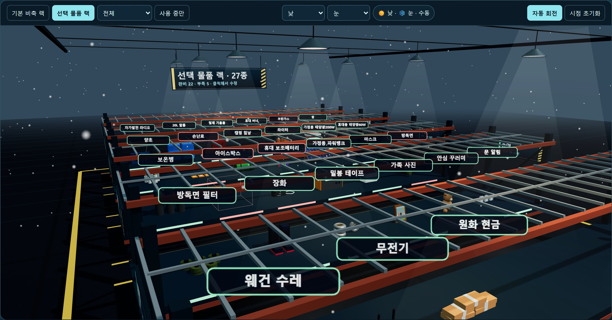
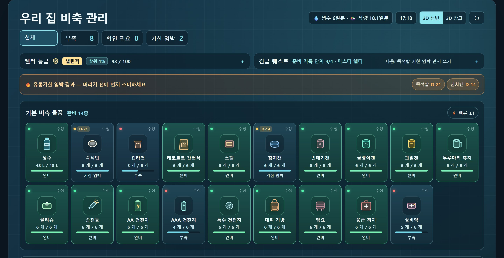
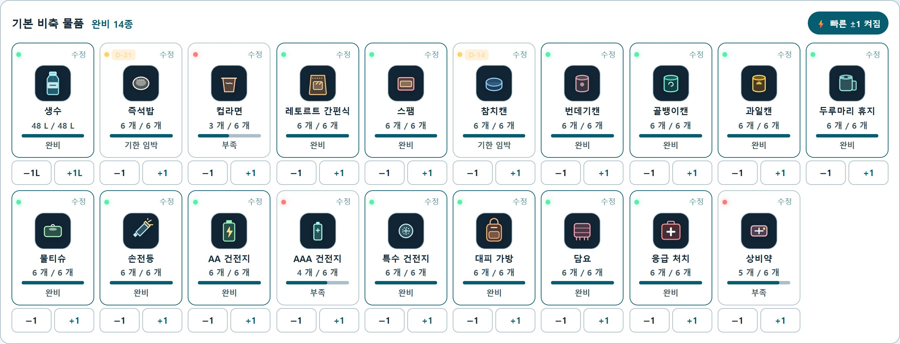

# KR Survival Kit

> **전쟁·재난이 닥쳐도 당황하지 않도록, 우리 집 생존 물품을 게임처럼 관리하는 Home Assistant 대시보드**

  
   3D 비축 창고 · 밤 모드

오늘 밤 공습경보가 울린다면, 우리 집에는 며칠을 버틸 물과 식량이 있을까요?

KR Survival Kit는 **전쟁·재난 때 살아남는 방법**을 알려 드리고, 생수·식량·약·건전지 같은 **생존 필수품을 쉽게 관리**하도록 만들었습니다. 물품을 채울수록 등급이 오르는 **게임처럼** 즐기면서 우리 집을 지켜 보세요.

> ⭐ 마음에 드셨다면 오른쪽 위의 **Star**를 눌러 주세요. 만드는 사람에게 큰 기쁨이 됩니다.

[할 수 있는 일](#할-수-있는-일) · [스크린샷](#스크린샷) · [설치](#설치) · [사용법](#사용법) · [자주 묻는 질문](#자주-묻는-질문) · [후원](#후원)

---

## 할 수 있는 일

| | |
|---|---|
| 💧 **며칠 버틸 수 있는지 한눈에** | 지금 있는 물과 식량으로 우리 가족이 며칠 버틸지 바로 보여 줍니다. |
| 🗓 **유통기한 알림** | 기한이 다가온 물품을 먼저 알려 줘서, 버리지 않고 먼저 먹고 다시 채울 수 있어요. |
| 🔋 **약·건전지도 기한 관리** | 해열제·소화제·감기약, 건전지, 정수 필터처럼 기한이 있는 물품도 날짜를 적어 둘 수 있어요. |
| 📦 **111가지 물품을 하나씩** | 생수·즉석밥·통조림부터 소독약·멸균 거즈·헤드랜턴까지 물품마다 따로 기록합니다. |
| ➕ **없는 물품은 직접 추가** | 반려견 사료, 캠핑 랜턴처럼 목록에 없는 물품도 이름만 적으면 추가돼요. |
| 📍 **어디에 뒀는지 기록** | "현관 팬트리", "주방 팬트리 3층 선반"처럼 적어 두면 필요할 때 바로 찾아요. |
| 🎮 **게임처럼 레벨업** | 물품을 채울수록 등급이 아이언 → 챌린저로 오르고, 할 일을 퀘스트로 알려 줍니다. |
| 🏭 **3D 창고** | 우리 집 비축품을 3D 창고로 둘러봐요. 실제 날씨에 따라 비·눈이 내리고 낮·밤이 바뀝니다. |
| 🚨 **비상 행동 안내** | 공습·화생방·정전·단수 때 무엇부터 할지 알려 주고, 경보음도 미리 들어 볼 수 있어요. |
| 🖨 **인터넷 없이도** | 냉장고에 붙일 A4 행동 카드와, 인터넷이 끊겨도 열리는 안내 파일을 드립니다. |

---

## 스크린샷

| 3D 창고 · 눈 오는 낮 | 3D 창고 · 비 오는 밤 |
|:---:|:---:|
|  |  |
| **3D 창고 · 가까이 보기** | **2D 선반 화면** |
|  |  |

  
   ⚡ 빠른 ±1 — 먹거나 사 왔을 때 버튼 한 번으로 수량 조절

---

## 설치

Home Assistant 2026.11 이상, 관리자 계정이 필요합니다.

**HACS로 설치 (추천)**
1. Home Assistant에서 **설정 → Marketplace → 링크로 추가**
2. 주소에 `redchupa/kr_survival_kit` 입력, 유형은 **통합(Integration)**
3. 다운로드 후 **Home Assistant 재시작**
4. **설정 → 기기 및 서비스 → 통합 추가 → KR Survival Kit** 선택, 가족 인원 입력
5. 왼쪽 메뉴에 **KR Survival Kit**가 생기면 끝!

직접 설치하기

1. **Code → Download ZIP**으로 내려받기
2. `custom_components/kr_survival_kit` 폴더를 HA 설정 폴더의 `custom_components/` 안에 복사
3. Home Assistant를 재시작하고 위 4~5단계 진행

---

## 사용법

1. **물품을 누르세요.** 수량과 유통기한을 적고 저장하면 끝이에요. `+1년`, `2L × 12병` 같은 버튼으로 빠르게 입력할 수 있어요.
2. **먹거나 사 오면 `⚡ 빠른 ±1`.** 창을 열지 않고 바로 수량을 바꿉니다. 기한이 빠른 것부터 줄어들어요.
3. **노란 알림이 뜨면 먼저 쓰세요.** 기한이 다가온 물품이에요. 쓰고 나서 새로 채우면 됩니다.
4. **목록에 없는 물품은** `선택 물품 → ＋ 물품 직접 추가`로 넣으세요.
5. **비상시에는 `상황 안내` 탭**에서 지금 해야 할 일을 확인하세요. 실제 상황에서는 공식 재난문자와 현장 안내를 먼저 따르세요.

> A4 행동 카드와 오프라인 안내는 HA 없이도 받을 수 있어요: [A4 PDF](custom_components/kr_survival_kit/www/kr-survival-kit-a4.pdf?raw=1) · [오프라인 안내](custom_components/kr_survival_kit/www/kr-survival-kit-offline.html?raw=1)

---

## 자주 묻는 질문

업데이트했는데 화면이 그대로예요

Home Assistant를 재시작한 뒤 브라우저에서 **Ctrl + Shift + R**(강력 새로고침)을 눌러 주세요.

왼쪽 메뉴에 안 보여요

관리자 계정으로 로그인했는지 확인하세요. 같은 주소(`kr-survival-kit`)의 대시보드를 직접 만든 적이 있다면 그 주소를 바꾼 뒤 통합을 다시 불러오세요.

기록을 다른 기기로 옮기고 싶어요

화면 아래 **💾 재고 백업 저장**으로 파일을 받고, 새 기기에서 **📂 백업 복원**을 누르면 됩니다. 직접 추가한 물품과 보관 위치도 함께 옮겨져요.

매주 알림을 받고 싶어요

[주간 알림 블루프린트](custom_components/kr_survival_kit/blueprints/automation/weekly_rotation_alert.yaml)를 가져오면 매주 기한 임박·부족 물품을 휴대폰으로 알려 줍니다.

내 재고 정보가 밖으로 나가나요?

아니요. 모든 기록은 우리 집 Home Assistant 안에만 저장됩니다. 선택 기능인 MQTT를 켜도 부족·확인 필요·기한 임박 **개수**만 보냅니다.

**버그 제보·아이디어**는 [GitHub 이슈](https://github.com/redchupa/kr_survival_kit/issues/new/choose)에 남겨 주세요. (주소·연락처·실제 재고 같은 개인정보는 올리지 마세요.) 코드로 참여하고 싶다면 [기여 안내](CONTRIBUTING.md)를 봐 주세요.

---

## 후원

도움이 되셨다면 작은 후원으로 응원해 주세요. 감사합니다!

- [GitHub Sponsors](https://github.com/sponsors/redchupa)
- [PayPal](https://www.paypal.com/ncp/payment/HG9KNC262PLAC)
- 토스 앱에서 아래 QR을 스캔해 후원할 수 있습니다.

---

## 마치며

안전은 미리 준비한 만큼 지켜집니다. KR Survival Kit가 "설마 우리 집이" 하는 안전불감증을 덜어 주고, 여러분의 가정에 늘 평화와 행복만이 함께하기를 바랍니다.

⭐ 도움이 되셨다면 **Star** 하나로 응원해 주세요.
